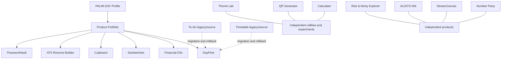

# 🧭 PALMI-D3V — Ecosystem Map & Chat Handoff

**Last reviewed:** 2026-10-18  
**Source of truth:** Each repository's main branch and its project-specific implementation/docs.  
**Purpose:** Factual starting point for a future conceptual map. This inventory does not claim that the applications are already integrated.

## 🌌 Ecosystem at a glance

| Project | Purpose | Relationship / current state |
|---|---|---|
| [DayFlow](https://github.com/palmid3v/dayflow-palmid3v) | Personal productivity hub | Canonical destination for tasks, recurring schedules, daily planning, reminders, review, calendar and memory. Unification/reconciliation still has release gates. |
| To-Do (repositorio fuente privado: palmid3v/to-do-palmid3v) | Task lifecycle | Legacy/source repository for task data and migration/rollback; do not retire until migration, permissions and history are verified. |
| Timetable (repositorio fuente privado: palmid3v/timetable-palmid3v) | Recurring schedules | Legacy/source repository for schedule data and migration/rollback; do not retire until reconciliation is verified. |
| [Financial-D3v](https://github.com/palmid3v/financial-d3v-palmid3v) | Private personal finance | Separate finance product; encrypted .fdv file is the persistence boundary. HTTPS is required for Web Crypto in normal browser use. |
| Sandwichies (repositorio fuente privado: palmid3v/sandwichies-palmid3v) | Sandwich configurator and business operations | Business product; ordering is intentionally disabled pending validation/release approval. Spreadsheet quantities/costs are authoritative. |
| Cupboard (repositorio fuente privado: palmid3v/cupboard-palmid3v) | Household inventory | Functional MVP in reliability hardening; Firestore-backed, mobile-first, barcode scanning. |
| ATS Resume Builder (repositorio fuente privado: palmid3v/ats-resume-builder-palmid3v) | Resume authoring and ATS guidance | Local-first; deterministic guidance and client-side PDF export. |
| [PasswordVault](https://github.com/palmid3v/passwordvault-palmid3v) | Desktop password manager | Tauri/Rust native vault layer; functional completion recorded, not independently security-certified. |
| PALMI-D3V Portfolio (repositorio fuente privado: palmid3v/portfolio-palmid3v) | Public product portfolio | Evidence-led bilingual presentation; keep claims synchronized with project repositories. |
| Theme Lab (repositorio fuente privado: palmid3v/bgc-changer-palmid3v) | Visual theme/color experiment | React-based theme playground; independent utility/experiment. |
| Calculator (repositorio fuente privado: palmid3v/calculator-palmid3v) | Browser calculator | Client-side utility; calculation history in local browser storage. |
| QR Generator (repositorio fuente privado: palmid3v/qr-generator-palmid3v) | QR creation | Client-side utility; no backend required for current scope. |
| Number Party (repositorio fuente privado: palmid3v/bingo-palmid3v) | Social multiplayer number game | Firebase realtime rooms; no betting or monetary prizes. |
| StreamCanvas (repositorio fuente privado: palmid3v/streamcanvas-palmid3v) | Vertical streaming-layout editor | Editor prototype documented as paused; confirm before planning new scope. |
| ALDO'S INK (repositorio fuente privado: palmid3v/tattoo-landing-page-palmid3v) | Tattoo artist portfolio | Client-style frontend landing page; artist brand is distinct from developer identity. |
| [Rick & Morty Explorer](https://github.com/palmid3v/Rick-Morty-VueJs-Tailwind) | Vue API learning project | Portfolio/learning experiment using public API. |
| [GitHub Profile](https://github.com/palmid3v/palmid3v) | Professional identity | Entry point for the ecosystem; not an application runtime. |

## 🔗 Known relationships (do not infer more than this)

Some source repositories are private; links and access follow each repository's GitHub visibility. A line in this diagram means portfolio or documented migration relationship only. It does not imply a shared runtime, unified authentication, cross-app API, data sync, or common deployment.

## 🧱 Documentation contract for every project

- **Public README:** product purpose, real implemented features, technology, run instructions, status, docs links and clear limits; use emojis consistently.
- **Internal context:** current architecture, source-of-truth files, decisions, validation evidence, known issues, next actions and exact branch/commit where relevant.
- **Roadmap / tasks / audit:** separate completed, in progress, blocked and planned work.
- **Evidence:** never claim tests, builds, security audits, migration, or release approval without recorded evidence.
- **Privacy:** do not publish secrets, tokens, personal user data, internal credentials, or private financial information.
- **History:** preserve old phase reports and decision traceability; correct outdated status in a current index rather than silently deleting history.

## 🚦 Current high-priority gates

1. **DayFlow:** close migration/data/permission/deployment reconciliation and authenticated E2E + rollback validation before retiring To-Do or Timetable.
2. **Sandwichies:** continue the phase A–D review; keep ordering disabled until business rules, Firestore security, automated tests, build, emulator and browser validation pass. Use the business spreadsheet as source of truth for quantities/costs.
3. **Financial-D3v:** validate save → lock → reopen on HTTPS, desktop and mobile; reconcile account-linked ledger changes with tests before treating candidate changes as release-ready.
4. **Cupboard:** validate scan → recognize → register → inventory on real mobile devices and test Firestore error rollback.
5. **PasswordVault:** retain the distinction between recorded functional completion and independent security certification.
6. **Other products:** verify implementation and run instructions against each repository before making public release claims.

## 🧭 Suggested next-chat workflow

1. Read this file and the selected project's CONTEXT.md.
2. Fetch current main, inspect recent commits and open pull requests.
3. Inspect code before changing any status statement.
4. Build a conceptual map with nodes (products, shared services, data stores) and edges (confirmed integration, migration, planned integration).
5. Mark every edge as implemented / in migration / planned / rejected and include its evidence.
6. Work one project at a time, preserve the $0 constraint where specified, validate, and update documentation before moving on.

## 📝 Documentation update log

- 2026-10-18: refreshed public README descriptions across 17 accessible repositories and created this ecosystem inventory.
- 2026-10-18: refreshed the internal CONTEXT.md handoff for all 17 repositories (created one for StreamCanvas, which did not have one).
- 2026-10-18: synchronized current release gates in the active roadmaps for DayFlow, Sandwichies, Cupboard, Financial-D3v, Portfolio, Bingo, Calculator, Timetable, Theme Lab, To-Do, ATS Resume Builder and StreamCanvas; refreshed PasswordVault finalization notes and the Sandwichies/Financial documentation entry points.
- Historical phase reports, sprint records, imported agent skill references and old audit artifacts were preserved rather than rewritten as if they were new evidence. They still require focused review when the corresponding implementation changes.
- This index is a handoff aid; each repository's code and its current project-specific docs remain authoritative for implementation detail.
