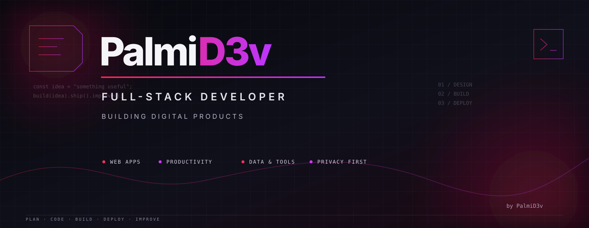

<!--
  PalmiD3v · GitHub Profile
  Keep public claims aligned with the implementation and current project documentation.
-->

# 🪐 PalmiD3v

### I turn ideas into digital products.

**Product-minded developer · Full-stack builder · UI/UX enthusiast**

I build useful software with thoughtful interfaces, clear architecture, and documentation that helps products keep growing.

[🌐 Portfolio](https://palmid3v.vercel.app/) · [💻 GitHub Projects](https://github.com/palmid3v?tab=repositories)

---

## 👋 About me

I'm **Carlos Palmieri**, the developer behind **PalmiD3v**.

I enjoy taking an idea from its first sketch to a working product: understanding the problem, shaping the experience, building the system, and improving it through testing and iteration.

My work spans productivity tools, personal-finance software, utilities, creative interfaces, and applications that solve everyday problems. I care about more than getting something to run: **the product should be understandable, maintainable, responsive, and honest about what it can do.**

## 🧩 What I build

- 🚀 **Digital products** — from focused browser utilities to full-stack applications.
- 🎨 **Interfaces with intention** — responsive UI, interaction design, accessibility, and product identity.
- 🧱 **Application architecture** — clear boundaries, reliable data flows, and maintainable code.
- 🔐 **Privacy-aware experiences** — thoughtful handling of authentication, local data, and sensitive information.
- 🧪 **Better engineering habits** — tests, release gates, technical documentation, and traceable decisions.
- 🤖 **AI-assisted workflows** — using AI to accelerate exploration and implementation while keeping code, evidence, and validation in control.

## 🚀 Selected work

<table>
  <tr>
    <td width="50%" valign="top">
      <h3>🌊 DayFlow</h3>
      
A personal productivity experience bringing tasks, recurring schedules, daily planning, reminders, review, and calendar workflows toward one coherent workspace.

      
<a href="https://github.com/palmid3v/dayflow-palmid3v">Explore repository ↗</a>

    </td>
    <td width="50%" valign="top">
      <h3>💰 Financial-D3v</h3>
      
A personal-finance and learning workspace built around an encrypted vault, local financial calculations, and privacy-conscious data handling.

      
<a href="https://github.com/palmid3v/financial-d3v-palmid3v">Explore repository ↗</a>

    </td>
  </tr>
  <tr>
    <td width="50%" valign="top">
      <h3>🔐 PasswordVault</h3>
      
A local-first desktop password manager combining a React interface with a native Tauri/Rust vault layer and KDBX4 support.

      
<a href="https://github.com/palmid3v/passwordvault-palmid3v">Explore repository ↗</a>

    </td>
    <td width="50%" valign="top">
      <h3>👽 Rick & Morty Explorer</h3>
      
A Vue 3 learning project exploring public API consumption, reusable components, routing, and character discovery.

      
<a href="https://github.com/palmid3v/Rick-Morty-VueJs-Tailwind">Explore repository ↗</a>

    </td>
  </tr>
</table>

For the broader product story, experiments, and project notes, visit the **[PALMI-D3V Portfolio](https://palmid3v.vercel.app/)**.

## 🛠️ Tools & technologies

  
  
  
  
  
  
  
  
  
  
  

*Technologies vary by project; this is the ecosystem I work with and explore, not a claim that every tool is used in every application.*

## 🧭 How I work

**Understand → Design → Build → Test → Document → Improve**

I prefer small, traceable steps over vague claims of completion. I document what exists, what is still in progress, and what evidence is needed before a release can be considered ready.

I’m also exploring how independent applications can share a coherent product ecosystem without forcing every project into the same architecture.

## 🌱 Always learning

Software is a craft of continuous iteration. I’m deepening my practice in full-stack development, data boundaries, security-conscious design, backend systems, and product thinking—one real problem at a time.

### Build with purpose. Ship with evidence. Keep improving. ✨

**[Explore my portfolio](https://palmid3v.vercel.app/) · [Browse my repositories](https://github.com/palmid3v?tab=repositories)**

